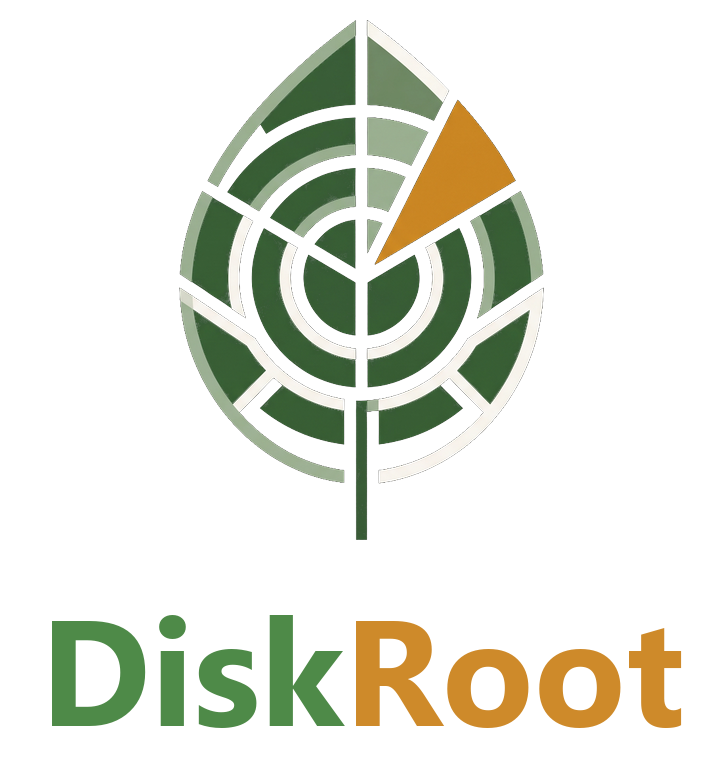

**DiskRoot {{VERSION}}**: a fast disk space analyzer for Windows 10/11. It shows what fills your drive, what each thing is, and whether it's safe to delete.

## New in 0.7.0
A new window, designed as "DiskRoot Studio", and a map that answers more questions. Still one small exe, offline, read-only scanning.

- **Studio window:** the map in the middle, the folder list on the left and the Inspector (what it is, is it safe, its size history) under the map. Both sides resize and minimize (**Ctrl+B**, **Ctrl+J**); **F** shows only the map.
- **Ctrl+K command palette:** every command and every folder or file by name, biggest first.
- **Map colours: Size, Growth, Reclaimable.** Growth shows what grew or shrank since the previous scan; Reclaimable shows what DiskRoot's rules label safe to clear (green) and caches or Windows leftovers to check first (amber). Personal folders aren't counted as reclaimable.
- **Optional 2.5D map** (2D stays the default): a tilted treemap "city" or a stepped sunburst, boxes standing up by size.
- **Breadcrumbs** on the map, short **transitions** when you open a folder, **notices** for what just happened, and a **Save space badge** with the biggest single way to get space back.
- **Studio look** (dark and Daylight) is the new default; the **Classic look** is under View.
- **Runs without a graphics driver:** if OpenGL can't start (virtual machines, some Remote Desktop sessions, the Basic Display Adapter), DiskRoot draws on the CPU instead, automatically. It redraws only what changed.
- **Slow PCs:** if the map's transitions draw at under ~20 frames a second, DiskRoot turns them off by itself (and says so).

## New in 0.6.1
- **New logo and app icon:** the DiskRoot leaf, without the dark tile, in the taskbar, Start menu, title bar, start screen and About.

## New in 0.6.0
- **DiskRoot.** New name, same promises: offline, read-only scanning, nothing changes without your OK. The command-line tool is **`droot`**: `droot scan C:\`, `droot health`, `droot writes`, `droot history`.
- **Upgrading from an earlier version:** just run the installer. It removes the previous version first (files, shortcuts, right-click entry, PATH entry, scheduled task) and keeps your settings and saved scans, which DiskRoot picks up on its first start. If you used scheduled scans, open View → Scheduled scans and press Save once.
- Downloads: `diskroot-setup.exe` and `diskroot-portable.zip`.

## New in 0.5.1
Fixes from a full audit of 0.5.0, before anything new:
- **Much less writing to your SSD:** DiskRoot's own saved scans are now compressed. Saving a scan of a 1.5 TB drive writes about 44 MB instead of ~150 MB, and the "while you were away" baseline costs nothing. The recommended scan interval also keeps DiskRoot's own writes under about 1 GB a day. Older saved scans still open.
- **Hardlinks counted once only where that's reliable:** on local NTFS drives. On ReFS and network drives every name counts again (their file IDs can't be trusted for this), so no real file can be shown as 0 B by mistake.
- **Started with "Run as administrator":** DiskRoot now says so, and its own scans stay folder walks; reading the raw drive happens only in the locked-down Fast-scan helper.
- **Fixed:** the app and a scheduled scan saving at the same moment could damage each other's files; live updates could count a hardlinked file twice again; the window redrew every second while live updates were on (idle CPU is now near zero); scheduling from a portable copy now warns that the task points at that file.
- **Honest numbers:** compression is about 5–9× faster than `compact.exe` in our test (not 15×), idle CPU is near zero (not zero), and scanning never changes your files but DiskRoot does save its own scans (docs updated).

## New in 0.5.0
DiskRoot now shows not only what fills your drive, but how the drive is doing and what wears it, and it can keep watch by itself. Everything still works without admin, offline, read-only.

- **Home (Ctrl+H):** the drive at a glance when DiskRoot opens: how full, when it would be full, drive health, what changed, the top ways to get space back, the biggest items.
- **Drive health (View → Drive health):** each SSD's own report in plain words: % of rated life used, data written and read, temperature, spare blocks, errors, TRIM. Writes per day over time, an honest life estimate (a range, only once there's data), and what you'd lose if the drive failed. Also `droot health`.
- **Who's writing (View → Who's writing):** the programs writing to your drives right now and while the PC is idle, next to the drive's own counter, and the folders that change most. Known offenders are flagged with what to do (e.g. AMD's `atieclxx.exe` bug of Nov 2026, Samsung 990 PRO firmware 0B2QJXD7), with sources. Also `droot writes`.
- **Scheduled scans (View → Scheduled scans):** DiskRoot can scan by itself every 30 minutes or more (it recommends how often), no admin, no window, nothing left running. When you open it: what changed while you were away. Optional notifications: low free space, fast growth, a program writing a lot while idle, a weekly report (each at most once a day/week).
- **Size history and forecast (View → Size history):** a chart for the drive and every folder, what grew in the last day/week/month, "C: would be full in about 40–70 days" (after a week of scans, never a date), log files that keep growing. Also `droot history`.
- **Where every GB is:** the drive's used space against what the scan counted, what the difference is, and the list of folders a normal scan couldn't read.
- **Hardlinks counted once in the normal scan:** e.g. C:\Windows 46 → 36 GB on our test PC. Your first scan after updating shows that drop once in What changed (it says why).
- **Smarter categories:** code projects (Node, Rust, Python, .NET, Java, Gradle, CMake, Go, Unreal) with their rebuildable parts marked safe to clear, AI models, datasets (csv, jsonl, ...), databases, temp files and unfinished downloads. "Unclassified" on our test drive: 22.8 → 1.6 GB. **Belongs to:** which installed program or Steam/Epic game a folder is part of. **Teach DiskRoot:** right-click a folder → This is… (my project, a dataset, a game, ...).
- **Light on your PC:** DiskRoot's own RAM and CPU in the status bar, free its memory with one click (the scan stays saved), gentle scanning, Save space and Home worked out off the UI thread.
- **Fixed:** a normal scan whose description mentioned the MFT was taken for a Fast scan in What changed (no warning when comparing the two methods).
- Keyboard shortcuts list (Help), screen-reader names for the map and its legend.

## In 0.4.1
- **One download, everything ready:** the installer now puts `droot` on PATH, so it works in any new terminal right after installing (the uninstaller removes exactly that entry again).
- **Always-latest links:** `diskroot-setup.exe` and `diskroot-portable.zip` on every release, so https://github.com/JayD108/DiskRoot/releases/latest/download/diskroot-setup.exe always gives the newest version.
- **Compress skips hardlinked files** (their data is shared with names that may be outside the folder you chose).
- **Save space warns** when the scan it uses was saved by an older DiskRoot without arrival dates.
- New guide for the command line: docs/CLI.md.

## In 0.4.0
- **Ways to save space** (the new **Save space** button): two lists from your scan, biggest first.
  - **Compress:** folders and big files whose files haven't changed or arrived for 1, 3, 6 or 12 months, with the expected saving and a one-click **Compress…** (Maximum suggested for things untouched for a year).
  - **Other ways:** caches and temp files, build folders in old projects, AI model stores, Recycle Bin, hibernation file, previous Windows, restore points, big files that won't compress, WSL/Docker disks, OneDrive copies, folder copies, old installers, duplicates and Compact OS, each with its size and exactly how.
  Nothing is changed from this window.
- **Arrival dates:** downloads and unpacked datasets keep their authors' old dates. DiskRoot now also reads when each file arrived on your PC, so a dataset downloaded last month no longer looks "2 years old".
- **Honest compression estimates** from real measurements per file type (e.g. text ~55%, EEG `.edf` ~33%, `.npy` ~15%, `.parquet`/`.pt` ~6–8% with Fast) instead of a flat 50%.
- **Safer cache labels:** a folder named `cache` inside your own projects is now "check first", not "safe to clear"; app caches in AppData stay safe.
- **Fixed:** the drive strip and totals at the bottom now update after Compress/Uncompress.
- **Help wanted:** a call for compression research and a list of open problems: see CONTRIBUTING.md and docs/HELP-WANTED.md.

## In 0.3
- Fast built-in compression (right-click → Compress…, ~15× faster than `compact.exe` in our tests, undoable), Similar folders, and fixes for compressed files in the normal scan and for "What changed" across scan methods.

## What it does
- Scans a whole NTFS drive in about 1–2 seconds by reading its Master File Table, read-only, after the Windows admin prompt. Without admin it walks folders (no prompt).
- Tree-table with a sunburst or treemap. Groups by location *or* by category (apps, media, dev stuff, AI & data, system, temp & caches…).
- Explains known folders in plain English with a safety label, and locks Windows and system folders.
- Deletes only to the Recycle Bin, after you confirm. It re-checks the item on disk first and warns about OneDrive folders, Git repositories and very large deletes. A deletion history is kept on your PC.
- **No network connections, no telemetry, no accounts.**

## Download
- **`diskroot-setup-{{VERSION}}.exe`**: installer (recommended). Installs into Program Files, which protects the admin helper used by Fast scan. Includes an uninstaller (Settings → Apps).
- **`diskroot-{{VERSION}}-portable.zip`**: no install. Unzip and run `diskroot.exe`.

Signature: {{SIGNED}}

## How it was built
Every file in this release was built by GitHub Actions from the tagged commit of [JayD108/DiskRoot](https://github.com/JayD108/DiskRoot). Check them against `SHA256SUMS.txt`.

**Privacy:** this program will not transfer any information to other networked systems unless specifically requested by the user or the person installing or operating it.
