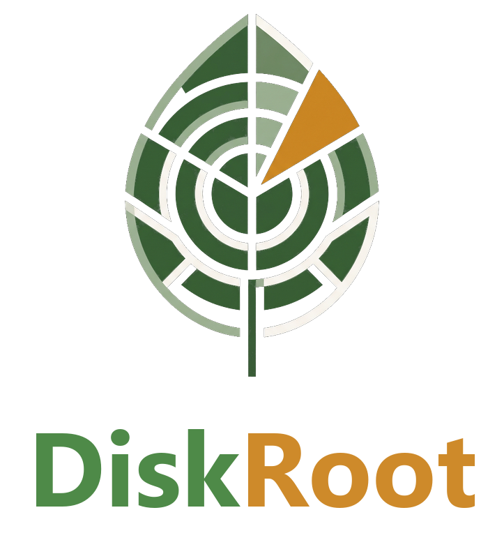
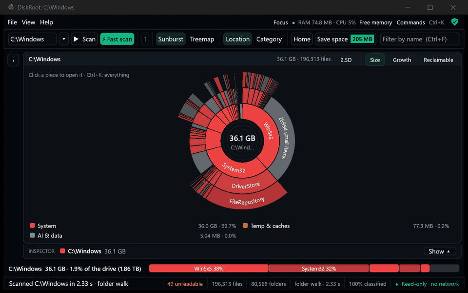
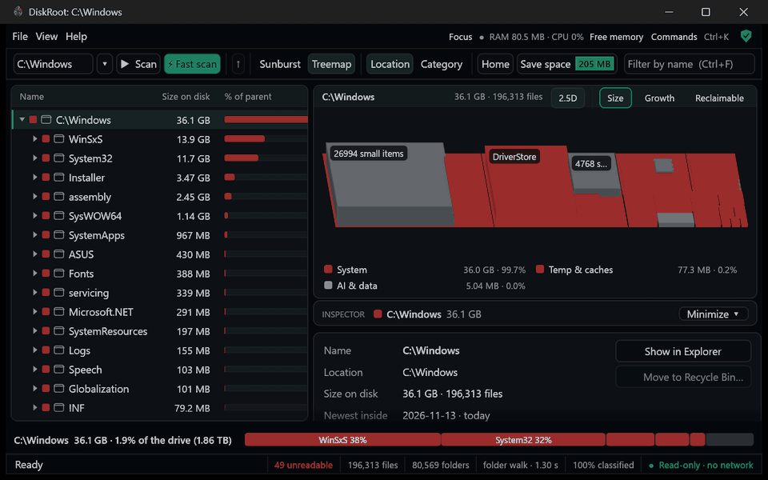

<div align="center">



### Get to the root of your disk.

**What's filling your drive · what each thing is · whether it's safe to delete · how the drive itself is doing**

A free, open-source disk analyzer for Windows 10 and 11. Offline. Read-only scanning. No admin needed.

<br>

<a href="https://github.com/JayD108/DiskRoot/releases/latest/download/diskroot-setup.exe"></a>

<sub>[Portable zip](https://github.com/JayD108/DiskRoot/releases/latest/download/diskroot-portable.zip) · [What's new](https://github.com/JayD108/DiskRoot/releases/latest) · about 4 MB · Windows 10 / 11, 64-bit</sub>

<br>

[](https://github.com/JayD108/DiskRoot/releases/latest)
[](https://github.com/JayD108/DiskRoot/releases)

[](#license)

**[Why](#why-diskroot)** · **[See it](#see-it-in-action)** · **[Features](#what-it-does)** · **[Trust](#measured-and-safe)** · **[Install](#get-started)** · **[FAQ](#faq)** · **[Docs](#learn-more)**

<br>


<sub>Real speed: a normal scan of C:\Windows (196,000 files), no admin.</sub>

</div>

## Why DiskRoot

Most disk tools stop at *"this folder is 13.9 GB"*. DiskRoot tells you what it is and what to do about it:

> **C:\Windows\WinSxS** · 13.9 GB · *System › Component store (WinSxS)* · **Don't delete by hand**
> Windows component store. Much of its apparent size is hardlinks shared with C:\Windows. Shrink safely with: `Dism /Online /Cleanup-Image /StartComponentCleanup` · **[Clean up with Windows…]**

What that means on a real PC (the developer's laptop: a 1.5 TB drive with 1.7 million files):

| Just counting sizes gives | DiskRoot shows |
|---|---|
| `C:\Windows` is **46 GB** | **36 GB**: 10 GB were the same files counted under two names (hardlinks) |
| **22.8 GB** of files nobody can explain | **1.6 GB** left: the rest turned out to be code projects, AI models, datasets, databases, temp files and unfinished downloads |
| "The drive is fine" | The SSD has used **1%** of its rated life, and here is who writes to it, also while the PC is idle |
| "Delete something" | **78 GB** of caches and temporary files, each with its safety label and exactly how to clear it |

## See it in action

<table>
<tr>
<td width="50%" valign="top">

<b>A map that answers questions.</b> Colour by size, growth or what's reclaimable; tilt it into 2.5D. (C:\Windows has almost nothing safe to clear, so Reclaimable is grey here, as it should be.)
</td>
<td width="50%" valign="top">

<b>Ctrl+K finds anything.</b> Every command and every folder by name. Here: <i>winsxs</i> → the Inspector says <b>Don't delete by hand</b> and offers the safe way.
</td>
</tr>
<tr>
<td valign="top">

<b>Home:</b> the drive at a glance, in four answers you can click.
</td>
<td valign="top">

<b>Coloured by age:</b> what hasn't been touched in years stands out.
</td>
</tr>
</table>

## What it does

| | |
|---|---|
| 🔎 **Know what everything is** | Every file gets a category (*Apps & Games, Dev stuff, AI & data, Media, System, Temp & caches…*) and a label: **safe to clear**, **check first** or **don't delete by hand**. It recognises code projects, AI models, datasets, and which program or Steam/Epic game a folder belongs to. |
| 🧹 **Get space back, safely** | **Save space** lists caches, old build folders, model stores, Recycle Bin, hibernation file, previous Windows, WSL/Docker disks, duplicates, and what to compress. Deleting goes to the Recycle Bin, after you confirm; Windows and system folders are locked. |
| 💚 **Drive health** | The SSD's own report in plain words: rated life used, data written, temperature, errors. Writes per day, an honest life estimate, and **which programs write to your drive**, also while idle. |
| 🕰️ **Keep watch** | Optional **scheduled scans** (no admin, no window: scan and exit), **what changed while you were away**, and *"C: would be full in about 40–70 days"*. |
| 🗜️ **Built-in compression** | Windows' own file compression on many files at once (about 5–9× faster than `compact.exe` in our test). Same files, less space, undoable. |
| 🖥️ **Runs on any PC** | One small exe. No graphics driver (VMs, Remote Desktop)? It draws on the CPU by itself. Slow PC? Animations turn off by themselves. Idle, it draws nothing. |

<details>
<summary><b>Everything else</b></summary>

- **Where every GB is:** the drive's used space next to what the scan counted, the folders a normal scan can't read, and what the rest is.
- **Fast scan:** with admin, a short-lived helper reads the drive's file table directly: a whole NTFS drive in 1–2 s. The window itself never needs admin.
- **Instant reopen:** your last scan opens in under a second; **What changed** points at the exact folders that grew or shrank.
- Largest files and types, duplicate finder, similar folders (`project`, `project_v2`, `project - Copy`), leftovers of uninstalled programs, live updates while open, size alerts.
- **Teach DiskRoot:** right-click a folder → *This is…* (my project, a dataset, a game…), or write your own rules.
- **Studio window:** the map in the middle, a folder list and an Inspector you can resize or minimize, Focus mode, breadcrumbs, notices. Studio look (dark or Daylight) or the Classic look.
- Its own RAM and CPU at the top, free its memory with one click, gentle scanning, screen-reader names for the map and the palette, a six-step guided tour.

Every feature, with what happens underneath: [FEATURES-AND-DEVELOPMENT.md](docs/FEATURES-AND-DEVELOPMENT.md).
</details>

### Keyboard

| <kbd>Ctrl</kbd>+<kbd>K</kbd> | <kbd>F5</kbd> | <kbd>Ctrl</kbd>+<kbd>F5</kbd> | <kbd>Ctrl</kbd>+<kbd>H</kbd> | <kbd>F</kbd> | <kbd>Ctrl</kbd>+<kbd>B</kbd> / <kbd>J</kbd> | <kbd>Ctrl</kbd>+<kbd>F</kbd> |
|:-:|:-:|:-:|:-:|:-:|:-:|:-:|
| find anything | scan | fast scan | Home | focus the map | hide list / Inspector | filter by name |

## Measured and safe

<table>
<tr>
<td width="45%" valign="top">

**Measured** on the developer's laptop (2 TB NVMe, 1.5 TB in 1.7 million files):

| | |
|---|---|
| ⚡ Fast scan, whole drive (admin) | 1–2 s |
| 🚶 Normal scan (no admin) | 4.3 s |
| 🔁 Reopen the last scan | 0.4 s |
| 💾 Saving a scan writes | 44 MB |
| 🪶 Idle CPU, window open | < 0.2% of a core |

Method: [BENCHMARKS.md](docs/BENCHMARKS.md)

</td>
<td valign="top">

**Safe by design**

| | |
|---|---|
| 🌐 **Offline** | No network code at all. Measured: zero connections during a full scan. No accounts, no telemetry. |
| 👀 **Read-only scanning** | A scan never changes your files. DiskRoot only saves its own scans in `%LOCALAPPDATA%\DiskRoot`. |
| ✋ **Nothing without your OK** | Delete → Recycle Bin after you confirm, re-checked on disk. Compress is undoable. Windows and Program Files are locked. |
| 🔐 **Least privilege** | The window doesn't need admin. Only a short-lived, locked-down helper reads the raw drive, after the Windows prompt. |
| 🧪 **Tested every release** | 150 tests, 2 million fuzz rounds per file parser, and a real install / upgrade / uninstall on a clean Windows machine. |

</td>
</tr>
</table>

Details: [SECURITY-AND-PRIVACY.md](docs/SECURITY-AND-PRIVACY.md) · report a problem privately: [SECURITY.md](SECURITY.md).

## Get started

1. **[Download `diskroot-setup.exe`](https://github.com/JayD108/DiskRoot/releases/latest/download/diskroot-setup.exe)** and run it.
2. Open **DiskRoot**, pick a drive, press **Scan** (F5), or **Fast scan** (Ctrl+F5) for a whole drive.
3. Click anything: the Inspector explains it. Press **Save space** for ways to get space back.
4. Want it to keep watch? **View → Scheduled scans.**

<details>
<summary>What the installer puts on your PC · portable use · silent install · upgrading</summary>

| | |
|---|---|
| `diskroot.exe` | The app, in Program Files (only admins can change it there, which keeps Fast scan safe) |
| `droot` | The command-line tool, already on PATH ([guide](docs/CLI.md)) |
| Start menu, right-click **Analyze with DiskRoot**, optional desktop shortcut | Pick them on the components page |
| Uninstaller | Settings → Apps → DiskRoot. Removes exactly what it installed, including the PATH entry and any scheduled scan |

- **No install?** The **[portable zip](https://github.com/JayD108/DiskRoot/releases/latest/download/diskroot-portable.zip)**: unzip anywhere, run `diskroot.exe` (Fast scan needs the installed version).
- **IT:** `diskroot-setup.exe /S` installs silently; `"C:\Program Files\DiskRoot\uninstall.exe" /S` removes it.
- **Upgrading:** just run the new installer; settings and saved scans stay.
</details>

### For the terminal

```text
> droot scan C:\ --top 5        what's biggest
> droot health                  is the SSD OK?
> droot writes --secs 10        who's writing right now?
> droot history C: --days 30    what grew this month, when it would be full
```

Every command has `--json` for scripts. Guide: [docs/CLI.md](docs/CLI.md).

## FAQ

<details>
<summary><b>Windows says "Windows protected your PC". Is it safe?</b></summary>

Releases aren't code-signed yet (a certificate costs money every year), so SmartScreen warns about any new download. Click **More info → Run anyway**. Every file is built by GitHub Actions from this repository, and you can check your download against `SHA256SUMS.txt` on the release page.
</details>

<details>
<summary><b>Does it send anything anywhere?</b></summary>

No. DiskRoot has no network code: no accounts, no telemetry, no update checks. We measure zero connections during a full scan. Your scans stay in `%LOCALAPPDATA%\DiskRoot`.
</details>

<details>
<summary><b>Can it delete something important by accident?</b></summary>

Scanning only reads. Deleting is always your choice: it goes to the Recycle Bin after a confirmation, each item is re-checked on disk first, and Windows and Program Files are locked, even under other spellings of the path.
</details>

<details>
<summary><b>Which drives does it work on?</b></summary>

Normal scan: any drive Windows can open: NTFS, FAT32, exFAT, USB sticks, network shares. It's tested most on NTFS SSDs, so reports from HDDs and other file systems are welcome. Fast scan reads the NTFS file table, so it needs a whole NTFS drive and the installed version. Drive health reads NVMe drives today (no admin needed); SATA and USB drives say so, and support for them is planned.
</details>

<details>
<summary><b>How is it different from WinDirStat or WizTree?</b></summary>

They're good at showing sizes. DiskRoot also tells you *what* each thing is, whether it's safe to delete and how, what changed since last time, and how the drive itself is doing, all offline. A speed comparison (an early DiskRoot 0.1 against WizTree 4.33, WinDirStat 2.9 and eDirStat 2.0, with the method) is in [BENCHMARKS.md](docs/BENCHMARKS.md).
</details>

<details>
<summary><b>Does it need admin?</b></summary>

No. Only Fast scan asks for it, through the Windows prompt, and then only a small helper runs as admin for a few seconds. Started as admin, the window itself warns you.
</details>

## Learn more

| | |
|---|---|
| 🛠️ [How it works](docs/HOW-IT-WORKS.md) | Under the hood: reading the drive, the data model, categories, the map, history, deleting, accuracy |
| 📖 [Features and development](docs/FEATURES-AND-DEVELOPMENT.md) | Every feature: what it does, how to use it, what happens underneath; building and tests |
| 🔒 [Security and privacy](docs/SECURITY-AND-PRIVACY.md) | What DiskRoot reads and never does, admin rights, your data on disk |
| 💻 [Command line](docs/CLI.md) | Every command and option, JSON and CSV, script examples |
| 📊 [Benchmarks](docs/BENCHMARKS.md) | Speed, compression and disk-write measurements, with the method |
| 🗺️ [Roadmap](docs/ROADMAP.md) | Releases and what's next |

## Help build it

DiskRoot is open for contributions, especially **compression**: text and programs save 50–70%, but float arrays only ~15% and model weights 6–8%. If you know compression, read the [call for compression research](CONTRIBUTING.md#call-for-compression-research-). Other open problems (drive health on more SSD brands, known offenders with sources, accessibility, testing): [HELP-WANTED.md](docs/HELP-WANTED.md).

Start with [CONTRIBUTING.md](CONTRIBUTING.md). Questions and ideas: [Discussions](https://github.com/JayD108/DiskRoot/discussions) · where to ask: [SUPPORT.md](SUPPORT.md) · everyone follows the [Code of Conduct](CODE_OF_CONDUCT.md).

If DiskRoot saved you some space, a ⭐ helps others find it.

## Acknowledgements

Claude (by Anthropic) was used as an AI assistant during the development of this project: for code, testing, security review and documentation. All work is reviewed and maintained by the project owner.

## License

MIT or Apache-2.0, at your option ([LICENSE-MIT](LICENSE-MIT), [LICENSE-APACHE](LICENSE-APACHE)).
