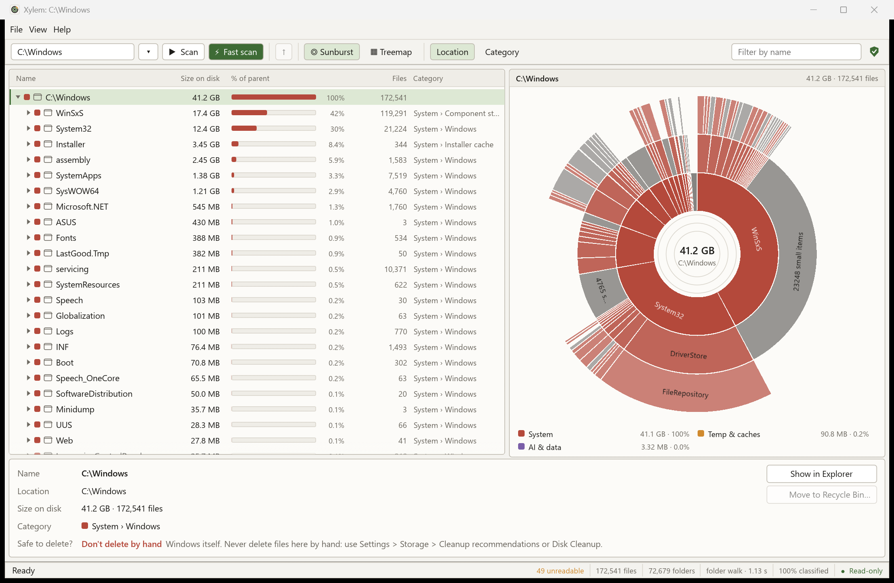
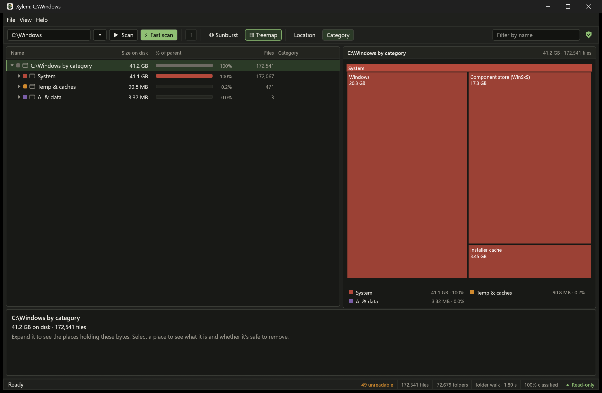

<div align="center">


# Xylem

### Your drive, explained.

**What's filling it · what each thing is · whether it's safe to delete · how the drive itself is doing**

Free and open source, for Windows 10 and 11. Offline. Read-only scanning. No admin needed.

[](https://github.com/JayD108/Xylem/releases/latest/download/xylem-setup.exe)

[portable zip](https://github.com/JayD108/Xylem/releases/latest/download/xylem-portable.zip) · [all releases](https://github.com/JayD108/Xylem/releases) · [what's new](https://github.com/JayD108/Xylem/releases/latest)

    

</div>



## Three questions, answered in seconds

| When your drive fills up you ask… | Xylem answers |
|---|---|
| 📍 **Where** is the space going? | A tree and a sunburst or treemap of every folder, by location or by category, with what changed since last time. |
| 🔎 **What** is it? | A game, `node_modules`, an AI model, a dataset, Windows itself: every file gets a category, known folders get a plain-English note, and Xylem says which program or game a folder belongs to. |
| ✅ **Is it safe to delete?** | *Safe to clear*, *check first* or *don't delete by hand*, and **every way to get space back** with how much each one gives. |

And one more nobody else asks: 💚 **is the drive itself OK?** Xylem reads each SSD's own health report and shows which programs are wearing it out.

## Measured, not promised

On the developer's laptop (a 2 TB NVMe drive holding 1.5 TB in 1.7 million files):

| | |
|---|---|
| ⚡ **Fast scan** of the whole drive (admin, reads the file table) | about 1–2 s |
| 🚶 **Normal scan** (no admin) | about 4.3 s |
| 🔁 **Reopen** the last scan | about 0.4 s |
| 🏷️ Files left **unclassified** | 1.6 GB of 1.56 TB (0.1%) |
| 🗜️ Built-in **compression** vs Windows' `compact.exe` | about 15× faster |
| 🪶 Idle CPU · network connections | 0 · 0 |

Method and more numbers: [BENCHMARKS.md](docs/BENCHMARKS.md).

## What you can do

<details open>
<summary><b>🏠 See it all at once</b></summary>

- **Home** (Ctrl+H, opens at start): how full the drive is, when it would be full, drive health, what changed, the top ways to get space back and the biggest items. One click into any of them.
- **Tree-table + sunburst or treemap**, by location or by category (*Apps & Games, Dev stuff, AI & data, Media, System, Temp & caches…*). Colour by age to spot what hasn't changed in years.
- **Where every GB is:** the drive's used space next to what the scan counted, and what the rest is.
</details>

<details open>
<summary><b>🧹 Get space back, safely</b></summary>

- **Save space:** what to compress (big, not changed or added for months, with measured estimates) and every other way: caches, old build folders, AI model stores, Recycle Bin, hibernation file, previous Windows, WSL/Docker disks, old installers, duplicates, Compact OS. Each with its size and exactly how.
- **Code projects understood:** Node, Rust, Python, .NET, Java, Gradle, CMake, Go and Unreal projects are recognised, and their rebuildable parts (`node_modules`, `target`, `bin`/`obj`, …) are marked safe to clear. *Mark all* takes every one in a click.
- **Compress… (right-click):** Xylem's own engine drives Windows' file compression on many files at once. Same files, less space, undoable, and it tells you the SSD writes it costs.
- **Careful deleting:** Recycle Bin only, after you confirm, re-checked on disk first. Windows and system folders are locked. Warnings for OneDrive, Git repositories, running apps and very large deletes.
- **Also:** largest files and types, duplicate finder, similar folders (`project`, `project_v2`, `project - Copy`), leftovers of uninstalled programs, a PowerShell cleanup plan to review, guided WSL/Docker disk compaction.
</details>

<details open>
<summary><b>💚 Drive health and who's writing</b></summary>

- **Drive health:** each SSD's own report in plain words: *"Good: 1% of rated life used"*, data written, temperature, spare, errors, TRIM. Writes per day over time, an honest life estimate (a range, only when there's data), and what you'd lose if the drive failed.
- **Who's writing:** the programs writing to your drives right now and **while the PC is idle**, next to the drive's own counter. Known offenders are flagged with what to do, with sources (like AMD's `atieclxx.exe` bug of Nov 2026).
- No admin needed for any of it.
</details>

<details open>
<summary><b>🕰️ Keep watch, without keeping anything running</b></summary>

- **Scheduled scans:** every 30 minutes or more (Xylem recommends how often). No admin, no window, nothing left running: each run scans, saves, and exits.
- **What changed while you were away**, a **size chart for every folder**, what grew this day/week/month, and *"C: would be full in about 40–70 days"* (after a week of scans, never a fake exact date).
- **Quiet warnings** (Windows notifications, at most once a day): low free space, fast growth, a program writing a lot while idle, a weekly report.
</details>

<details>
<summary><b>🪶 Light, private, yours</b></summary>

- Shows its own RAM and CPU; free its memory with one click (your scan stays saved); gentle scanning keeps other programs fast.
- **Teach Xylem:** right-click a folder → *This is…* (my project, a dataset, a game…), or write your own rules.
- Light and dark themes, full keyboard control (Help → Keyboard shortcuts), screen-reader names for the map.
- No network code at all, no accounts, no telemetry. One small program (~8 MB).
</details>

Every feature, with what happens underneath: [FEATURES-AND-DEVELOPMENT.md](docs/FEATURES-AND-DEVELOPMENT.md).



## Get started in a minute

1. **[Download `xylem-setup.exe`](https://github.com/JayD108/Xylem/releases/latest/download/xylem-setup.exe)** (about 3 MB) and run it. Releases aren't signed yet, so Windows may say *"Windows protected your PC"*: click **More info → Run anyway** (check the file against `SHA256SUMS.txt` on the [release page](https://github.com/JayD108/Xylem/releases/latest) if you like).
2. Open **Xylem**, pick a drive, press **Scan** (F5), or **Fast scan** (Ctrl+F5) for a whole drive.
3. Click around: anything you select is explained at the bottom.
4. Press **Save space**. Turn on **View → Scheduled scans** if you want Xylem to keep watch.

<details>
<summary>What the installer puts on your PC, portable use, silent install</summary>

| | |
|---|---|
| `xylem.exe` | The app, in Program Files (only admins can change it there, which keeps Fast scan safe) |
| `xylem-cli` | The command-line tool, already on PATH ([guide](docs/CLI.md)) |
| Start menu, right-click **Analyze with Xylem**, optional desktop shortcut | Pick them on the components page |
| Uninstaller | Settings → Apps → Xylem. Removes exactly what it installed, including the PATH entry and any scheduled scan |

**No install?** Use the **[portable zip](https://github.com/JayD108/Xylem/releases/latest/download/xylem-portable.zip)**: unzip anywhere, run `xylem.exe` (Fast scan needs the installed version).
**IT:** `xylem-setup.exe /S` installs silently; `"C:\Program Files\Xylem\uninstall.exe" /S` removes it.
</details>

## For the terminal

```text
> xylem-cli scan C:\ --top 5          what's biggest
> xylem-cli health                    is the SSD OK?
> xylem-cli writes --secs 10          who's writing right now?
> xylem-cli history C: --days 30      what grew this month, when it would be full
```

Every command has `--json` for scripts. Guide: [docs/CLI.md](docs/CLI.md).

## How it stays safe

```
 You ──► xylem.exe (normal user) ──► Scan: walks folders, no admin needed
                │
                └── Fast scan ──► Windows asks for admin ──► a short-lived helper reads the
                                  drive's file table (read-only), hands the result back, exits
```

- **Offline:** no network code at all. **Read-only:** scanning never writes to your drive.
- **Nothing changes without your OK:** delete goes to the Recycle Bin, compression is undoable, Save space only suggests.
- **Least privilege:** the window never runs as admin; scheduled scans never ask for it.
- **Tested before every release:** no network connections, read-only scanning, the admin helper's limits, fuzzing of every file parser. The shield button in the app shows exactly what Xylem does.

Details: [SECURITY-AND-PRIVACY.md](docs/SECURITY-AND-PRIVACY.md). Report a problem privately: [SECURITY.md](SECURITY.md).

## Learn more

| | |
|---|---|
| 🛠️ [How it works](docs/HOW-IT-WORKS.md) | Under the hood: reading the drive, the data model, categories, the map, history, deleting, accuracy |
| 📖 [Features and development](docs/FEATURES-AND-DEVELOPMENT.md) | Every feature: what it does, how to use it, what happens underneath; building and tests |
| 🔒 [Security and privacy](docs/SECURITY-AND-PRIVACY.md) | What Xylem reads and never does, admin rights, your data on disk |
| 💻 [Command line](docs/CLI.md) | Every command and option, JSON and CSV, script examples |
| 📊 [Benchmarks](docs/BENCHMARKS.md) | Speed and compression measurements, with the method |
| 🗺️ [Roadmap](docs/ROADMAP.md) | Releases and what's next |

## Help build it

Xylem is open for contributions, and one area especially: **compression**. Text and programs save 50–70%, but float arrays save ~15% and model weights only 6–8%. If you know compression, read the [call for compression research](CONTRIBUTING.md#call-for-compression-research-). Other open problems (drive health on more SSD brands, known offenders with sources, accessibility, testing) are in [HELP-WANTED.md](docs/HELP-WANTED.md). Start with [CONTRIBUTING.md](CONTRIBUTING.md).

## Acknowledgements

Claude (by Anthropic) was used as an AI assistant during the development of this project: for code, testing, security review and documentation. All work is reviewed and maintained by the project owner.

## License

MIT or Apache-2.0, at your option ([LICENSE-MIT](LICENSE-MIT), [LICENSE-APACHE](LICENSE-APACHE)).
