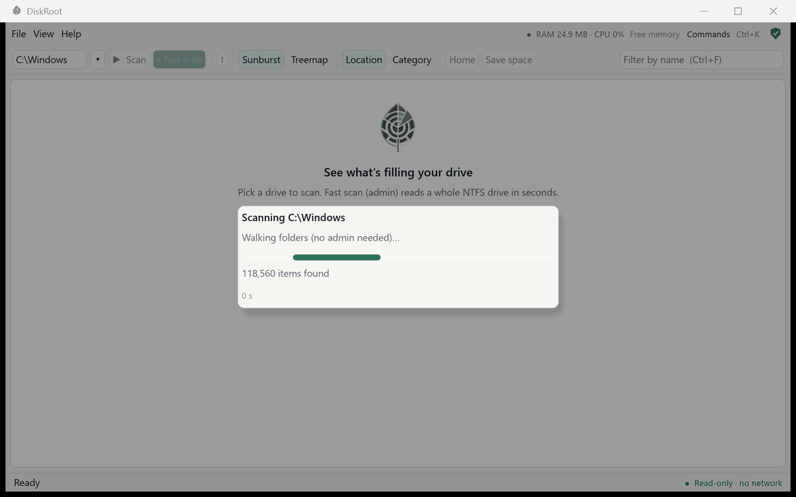
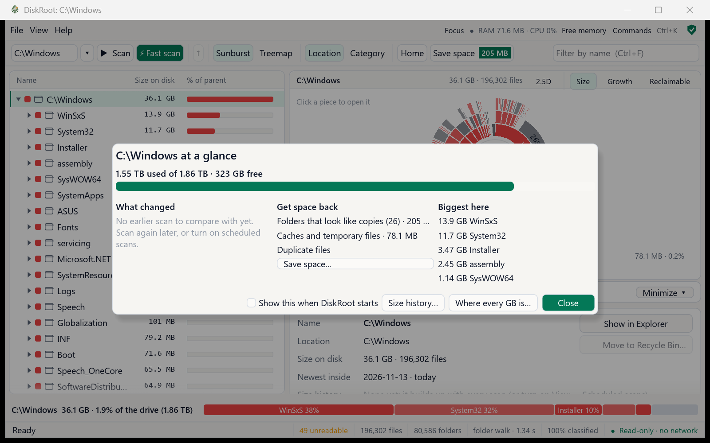
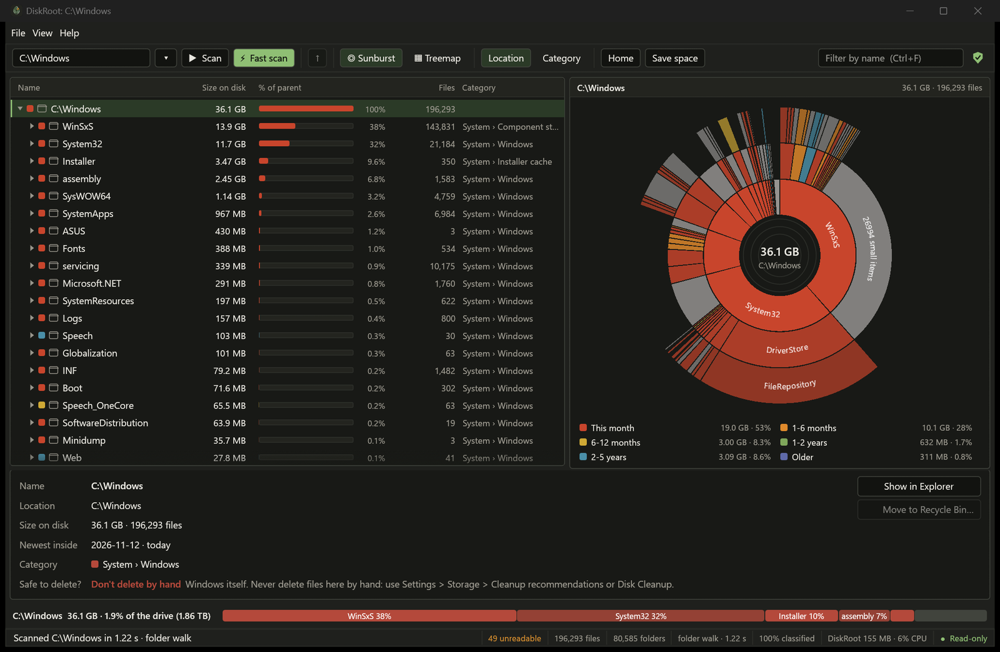

<div align="center">


### Get to the root of your disk.

**What's filling your drive · what each thing is · whether it's safe to delete · how the drive itself is doing**

A free, open-source disk analyzer for Windows 10 and 11. Offline. Read-only scanning. No admin needed.

<br>

<a href="https://github.com/JayD108/DiskRoot/releases/latest/download/diskroot-setup.exe"></a>

<sub>[Portable zip](https://github.com/JayD108/DiskRoot/releases/latest/download/diskroot-portable.zip) · [What's new](https://github.com/JayD108/DiskRoot/releases/latest) · about 3 MB · Windows 10 / 11, 64-bit</sub>

<br>

[](https://github.com/JayD108/DiskRoot/actions/workflows/ci.yml)
[](https://github.com/JayD108/DiskRoot/releases/latest)
[](https://github.com/JayD108/DiskRoot/releases)


[](#license)

**[Why](#why-diskroot)** · **[Features](#what-it-does)** · **[Is it safe?](#is-it-safe)** · **[Install](#get-started)** · **[Command line](#for-the-terminal)** · **[Docs](#learn-more)**

<br>



</div>

## Why DiskRoot

Most disk tools stop at *"this folder is 13.9 GB"*. DiskRoot tells you what it is and what to do about it:

> **C:\Windows\WinSxS** · 13.9 GB · *System › Component store (WinSxS)* · **Don't delete by hand**
> Windows component store. Much of its apparent size is hardlinks shared with C:\Windows. Shrink safely with: `Dism /Online /Cleanup-Image /StartComponentCleanup` · **[Clean up with Windows…]**

What that means on a real PC (the developer's laptop: a 1.5 TB drive with 1.7 million files):

| Just counting sizes gives | DiskRoot shows |
|---|---|
| `C:\Windows` is **46 GB** | **36 GB**: 10 GB were the same files counted under two names (hardlinks) |
| **22.8 GB** of files nobody can explain | **1.6 GB** left: the rest turned out to be code projects, AI models, datasets, databases, temp files and unfinished downloads |
| "The drive is fine" | The SSD has used **1%** of its rated life, and here is who writes to it, also while the PC is idle |
| "Delete something" | **78 GB** of caches and temporary files, each with its safety label and exactly how to clear it |

## What it does

<table>
<tr>
<td width="50%" valign="top">

### 🏠 See it all at once
**Home** opens with how full the drive is, when it would be full, the drive's health, what changed and the top ways to get space back, one click from each. A tree with a sunburst or treemap, by location or by category, coloured by age if you like.

</td>
<td width="50%" valign="top">

### 🔎 Know what everything is
Every file gets a category (*Apps & Games, Dev stuff, AI & data, Media, System, Temp & caches…*), known folders a plain-English note and a label: **safe to clear**, **check first** or **don't delete by hand**. It recognises code projects, AI models and datasets, and says which program or Steam/Epic game a folder belongs to.

</td>
</tr>
<tr>
<td valign="top">

### 🧹 Get space back, safely
**Save space** lists what to compress (big, unchanged for months, measured estimates) and every other way: caches, old build folders, model stores, Recycle Bin, hibernation file, previous Windows, WSL/Docker disks, duplicates. Deleting goes to the Recycle Bin only, after you confirm, re-checked on disk; Windows and system folders are locked.

</td>
<td valign="top">

### 💚 Drive health and who's writing
Each SSD's own report in plain words: rated life used, data written, temperature, errors, TRIM. Writes per day, an honest life estimate, and **which programs write to your drive**, also while the PC is idle, with known offenders flagged (like AMD's `atieclxx.exe` bug).

</td>
</tr>
<tr>
<td valign="top">

### 🕰️ Keep watch, without running all the time
Optional **scheduled scans** (every 30 min or more, no admin, no window: each run scans and exits), **what changed while you were away**, a size chart for every folder and *"C: would be full in about 40–70 days"*. Quiet warnings, at most once a day.

</td>
<td valign="top">

### 🗜️ Built-in compression
Right-click → **Compress…**: Windows' own file compression, on many files at once (about 5–9× faster than `compact.exe` in our test). Same files, less space, undoable, and it tells you the SSD writes it costs.

</td>
</tr>
<tr>
<td valign="top">

### 🗺️ A map that answers questions
Colour it by **Size**, by **Growth** since the last scan, or by what's **Reclaimable** (safe to clear in green, caches to check in amber). Tilt it into **2.5D** if you like. **Ctrl+K** finds any command or folder by name.

</td>
<td valign="top">

### 🖥️ Runs on any PC
One small exe. No graphics driver? DiskRoot draws on the CPU by itself (virtual machines, Remote Desktop). Slow PC? It turns its animations off by itself. Idle, it draws nothing.

</td>
</tr>
</table>

<p align="center">


</p>

<details>
<summary><b>Everything else</b></summary>

- **Where every GB is:** the drive's used space next to what the scan counted, the folders a normal scan can't read, and what the rest is.
- **Fast scan:** with admin, a short-lived helper reads the drive's file table directly: a whole NTFS drive in 1–2 s. The window itself never needs admin.
- **Instant reopen:** your last scan opens in under a second; **What changed** points at the exact folders that grew or shrank.
- Largest files and types, duplicate finder, similar folders (`project`, `project_v2`, `project - Copy`), leftovers of uninstalled programs, live updates while open, size alerts.
- **Teach DiskRoot:** right-click a folder → *This is…* (my project, a dataset, a game…), or write your own rules.
- **Studio window:** the map in the middle, a folder list and an Inspector you can resize or minimize (Ctrl+B, Ctrl+J), Focus mode (F), breadcrumbs, notices. Studio look (dark or Daylight) or the Classic look.
- Its own RAM and CPU at the top, free its memory with one click, gentle scanning, keyboard shortcuts, screen-reader names for the map and the palette.

Every feature, with what happens underneath: [FEATURES-AND-DEVELOPMENT.md](docs/FEATURES-AND-DEVELOPMENT.md).
</details>

## Measured, not promised

On the developer's laptop (2 TB NVMe, 1.5 TB in 1.7 million files):

| | |
|---|---|
| ⚡ Fast scan of the whole drive (admin) | about 1–2 s |
| 🚶 Normal scan (no admin) | about 4.3 s |
| 🔁 Reopen the last scan | about 0.4 s |
| 💾 What saving a scan writes to the SSD | about 44 MB (compressed) |
| 🪶 Idle CPU with the window open · network connections | under 0.2% of one core · 0 |

Method and more numbers: [BENCHMARKS.md](docs/BENCHMARKS.md).

## Is it safe?

| | |
|---|---|
| 🌐 **Offline** | No network code at all. Measured: zero connections during a full scan. No accounts, no telemetry. |
| 👀 **Read-only scanning** | Folders are opened for listing only, drives read-only. A scan never changes your files; DiskRoot saves its own scans (compressed) in `%LOCALAPPDATA%\DiskRoot`. |
| ✋ **Nothing without your OK** | Delete goes to the Recycle Bin after you confirm, Compress is undoable, Save space only suggests. Windows and Program Files are locked, even under other spellings of the path. |
| 🔐 **Least privilege** | The window doesn't need admin (started as admin, it warns). Only a short-lived, locked-down helper reads the raw drive, after the Windows prompt. Scheduled scans never ask for admin. |
| 🧪 **Tested every release** | 149 tests, 2 million fuzz rounds per file parser, checks for network sockets, read-only scanning and planted DLLs, and a real install / upgrade / uninstall on a clean Windows machine. |
| ⚠️ **"Windows protected your PC"** | Releases aren't code-signed yet, so SmartScreen may warn: click **More info → Run anyway**. Every file is built by GitHub Actions from this repository; check it against `SHA256SUMS.txt` on the release page. |

Details: [SECURITY-AND-PRIVACY.md](docs/SECURITY-AND-PRIVACY.md) · report a problem privately: [SECURITY.md](SECURITY.md).

## Get started

1. **[Download `diskroot-setup.exe`](https://github.com/JayD108/DiskRoot/releases/latest/download/diskroot-setup.exe)** and run it.
2. Open **DiskRoot**, pick a drive, press **Scan** (F5), or **Fast scan** (Ctrl+F5) for a whole drive.
3. Click anything: it's explained at the bottom. Press **Save space** for ways to get space back.
4. Want it to keep watch? **View → Scheduled scans.**

<details>
<summary>What the installer puts on your PC · portable use · silent install · upgrading</summary>

| | |
|---|---|
| `diskroot.exe` | The app, in Program Files (only admins can change it there, which keeps Fast scan safe) |
| `droot` | The command-line tool, already on PATH ([guide](docs/CLI.md)) |
| Start menu, right-click **Analyze with DiskRoot**, optional desktop shortcut | Pick them on the components page |
| Uninstaller | Settings → Apps → DiskRoot. Removes exactly what it installed, including the PATH entry and any scheduled scan |

- **No install?** The **[portable zip](https://github.com/JayD108/DiskRoot/releases/latest/download/diskroot-portable.zip)**: unzip anywhere, run `diskroot.exe` (Fast scan needs the installed version).
- **IT:** `diskroot-setup.exe /S` installs silently; `"C:\Program Files\DiskRoot\uninstall.exe" /S` removes it.
- **Upgrading:** just run the new installer; settings and saved scans stay.
</details>

## For the terminal

```text
> droot scan C:\ --top 5        what's biggest
> droot health                  is the SSD OK?
> droot writes --secs 10        who's writing right now?
> droot history C: --days 30    what grew this month, when it would be full
```

Every command has `--json` for scripts. Guide: [docs/CLI.md](docs/CLI.md).

## Learn more

| | |
|---|---|
| 🛠️ [How it works](docs/HOW-IT-WORKS.md) | Under the hood: reading the drive, the data model, categories, the map, history, deleting, accuracy |
| 📖 [Features and development](docs/FEATURES-AND-DEVELOPMENT.md) | Every feature: what it does, how to use it, what happens underneath; building and tests |
| 🔒 [Security and privacy](docs/SECURITY-AND-PRIVACY.md) | What DiskRoot reads and never does, admin rights, your data on disk |
| 💻 [Command line](docs/CLI.md) | Every command and option, JSON and CSV, script examples |
| 📊 [Benchmarks](docs/BENCHMARKS.md) | Speed, compression and disk-write measurements, with the method |
| 🗺️ [Roadmap](docs/ROADMAP.md) | Releases and what's next |

## Help build it

DiskRoot is open for contributions, especially **compression**: text and programs save 50–70%, but float arrays only ~15% and model weights 6–8%. If you know compression, read the [call for compression research](CONTRIBUTING.md#call-for-compression-research-). Other open problems (drive health on more SSD brands, known offenders with sources, accessibility, testing): [HELP-WANTED.md](docs/HELP-WANTED.md). Start with [CONTRIBUTING.md](CONTRIBUTING.md). If DiskRoot saved you some space, a ⭐ helps others find it.

## Acknowledgements

Claude (by Anthropic) was used as an AI assistant during the development of this project: for code, testing, security review and documentation. All work is reviewed and maintained by the project owner.

## License

MIT or Apache-2.0, at your option ([LICENSE-MIT](LICENSE-MIT), [LICENSE-APACHE](LICENSE-APACHE)).
