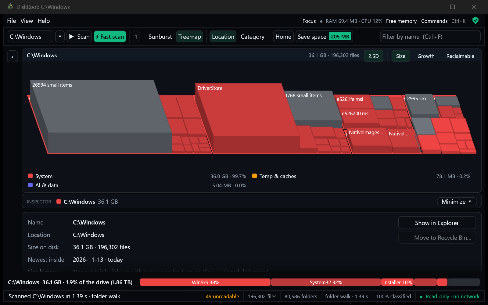

# Features and development

[← Back to README](../README.md) · How the engine works inside: [HOW-IT-WORKS.md](HOW-IT-WORKS.md) · Safety details: [SECURITY-AND-PRIVACY.md](SECURITY-AND-PRIVACY.md)

This page explains every feature of DiskRoot 0.2: **what it does, how to use it, and what happens underneath.** The second half is for people who want to build or change DiskRoot.

**Contents**
1. [Scanning](#1-scanning)
2. [Seeing where the space goes](#2-seeing-where-the-space-goes)
3. [Understanding what things are](#3-understanding-what-things-are)
4. [Change over time](#4-change-over-time)
5. [Finding space](#5-finding-space)
6. [Cleaning up](#6-cleaning-up)
7. [Power tools](#7-power-tools)
8. [Settings, files and shortcuts](#8-settings-files-and-shortcuts)
9. [Build from source](#9-build-from-source)
10. [Command line](#10-command-line)
11. [Tests](#11-tests)
12. [Releases](#12-releases)
13. [Project layout](#13-project-layout)

---

## 1. Scanning

### Scan (F5): no admin needed
- **What it does:** lists every folder and file under the drive or folder in the path box, with sizes.
- **Use it:** type or pick a path (top-left), press **Scan** or F5. Works on any drive: NTFS, FAT32, exFAT, USB sticks, network shares.
- **Underneath:** worker threads (one per CPU core, 4–32) ask Windows for whole folder listings at once (`NtQueryDirectoryFile`), hundreds of entries per call, each with its size, attributes and last-modified time. Each folder is opened relative to its parent, so long paths don't matter. Links (junctions, symlinks) are recorded but never followed, so nothing is counted twice through a loop. A full 1.5 TB system drive takes about 4–5 s.
- **Hardlinks counted once:** the listing includes each file's ID (NTFS, ReFS), so a file with several names (hardlinks, e.g. Windows' `WinSxS` and `System32`) counts once. The name outside `WinSxS` keeps the bytes (otherwise the alphabetically first path), the same on every scan; the other names show 0 B and say why. On the developer's C:\Windows: 46.1 GB before, 36.1 GB now; on all of C: about 20 GB less, 148,580 extra names. Cost: +18 MB peak memory (130 → 148 MB for a full C: walk), same speed. The first scan after updating shows that drop in What changed once.
- **Limits:** folders your account can't read are "unreadable": click the count in the status bar for the list (and why). Their size isn't counted; Fast scan includes them.

### Where every GB is (View → Where every GB is, or click the drive strip)
- **What it does:** for a whole drive, the used space Windows reports next to what the scan counted, and what the difference is. After a Fast scan it also shows NTFS's own files (`$MFT`, `$LogFile`, ...) and System Volume Information (restore points, shadow copies) measured, and whatever is still not in any file is shown as such, never guessed. After a normal scan it says what a folder walk can't see (unreadable folders, NTFS's own files, restore points, reserved storage) and offers a Fast scan.
- **Underneath:** used = volume size − free space (Windows); counted = the scan's size on disk. NTFS's own files can't be measured without admin (`FSCTL_GET_NTFS_VOLUME_DATA` is refused, measured).

### Fast scan (Ctrl+F5): whole NTFS drives, with admin
- **What it does:** reads the drive's own file table directly. About 1 s for a whole 1.5 TB drive, and it sees everything, including system folders and space Windows uses for itself.
- **Use it:** pick a drive (C:\) and press **Fast scan**. Windows asks for admin rights; click Yes.
- **Underneath:**
  1. DiskRoot starts a short-lived copy of itself as admin (the *helper*), with only one job.
  2. The helper opens the drive for reading, opens a private pipe back to the window, and then **gives up its admin power** (no privileges, Low integrity, no child processes) before it reads any data.
  3. It reads the Master File Table in 4 MB blocks on several threads, turns ~2 million records into a tree, sends it through the pipe and exits.
  4. The window (never admin) checks everything it receives before using it.
- **Limits:** NTFS only. For safety, release builds only do this from an installed copy (Program Files), not from a portable copy in Downloads.

### While it scans
- The window shows a radar: a sweep (emerald for Fast scan, amber for a normal scan) over growth rings, points lighting up as items are found, the number found so far, and, when the same place was scanned before, about how far along it is. Fast scan can be cancelled.

### Cancel and progress
- A running walk shows how many items it found so far. Fast scan has a **Cancel** button and a 10-minute limit.

---

## 2. Seeing where the space goes

### The Studio window
- **Layout:** the map in the middle, the folder list on the left, the **Inspector** under the map (what the selected item is, whether it's safe to delete, its size history, and Compress / Recycle Bin). Drag the edges to resize; **Ctrl+B** / **Ctrl+J** (or View) minimize the list / the Inspector; DiskRoot remembers that.
- **Focus (F):** only the map; Esc brings the rest back.
- **Command palette (Ctrl+K, or Commands at the top):** type a few letters: every command, and every folder or file in the scan by name, biggest first. ↑ ↓ Enter.
- **Top row:** DiskRoot's own RAM and CPU (click for details), Free memory, Focus, Commands, Security. The status bar ends with "Read-only · no network".
- **Save space badge:** the biggest single way to get space back (not a sum: some ways overlap).
- **Notices:** what just happened (moved to the Recycle Bin, exported, memory freed, errors) pops up bottom-right for a few seconds.
- **Looks:** Studio (dark or Daylight) by default; View → Classic look for the warm paper and moss green of earlier versions.
- **Underneath:** the palette's name search is one pass over the scan with no allocation per name (about 4 ms on a 1.7M-file drive).

### The tree-table
- **What it shows:** each folder's size on disk, a bar and percentage of its parent, the number of files, the category, and (after a rescan) how much it changed.
- **Use it:** click the triangle or press → to open a folder, ← to close it. Double-click opens too. **Ctrl+F** filters by name.
- **Underneath:** the tree only builds rows for open folders, and at most 2,000 children per folder (the rest are summed into "+ N smaller items"). So it stays instant even on folders with 100,000 files.

### The map: sunburst or treemap
- **Sunburst:** the current folder in the middle, each ring one level deeper, each slice as wide as its share of the space. Labels curve along the rings.
- **Treemap:** nested rectangles, area = size.
- **Use it:** click a slice to go into it, click the middle (or press Backspace) to go up. Hover for details. Switch in the toolbar or the View menu.
- **Underneath:** the engine sends the map a *pruned view*: about 6 levels deep, with anything under 0.2% merged into "N small items". The map never draws millions of shapes, and its layout is cached until the window size or the folder changes. It only redraws when you move the mouse or something changes.
- **Breadcrumbs:** the path to the folder on the map, each level clickable.
- **Colours: Size / Growth / Reclaimable** (switch in the map's title, or Ctrl+K):
  - **Size:** by category (or by age, below).
  - **Growth:** each folder against the previous scan of the same place: grew a lot, grew, about the same, shrank, new. Files and folders under 1 MB aren't tracked between scans (grey).
  - **Reclaimable:** green = what DiskRoot's rules label *safe to clear*; amber = *check first* places that are still space to get back (caches, Windows leftovers with a Windows cleanup tool). Documents, Downloads and other personal folders are "check first" too, but they aren't reclaimable space, so they're not counted. Each place is counted once; protected places never. About 9 ms for a whole drive.
- **2.5D (optional, the "2.5D" switch or View → Tilted map):** the same map tilted: treemap boxes stand up by size (square root, so small ones still show), the sunburst becomes a low stepped relief. Flat polygons drawn back to front, no 3D engine; clicks and hover hit what you see.
  
- **Transitions:** a short sweep / grow (220 ms) when the map opens a folder or goes up; it redraws only while it moves. View → Smooth transitions turns it off.

### Group by location or by category
- **Location:** the folder tree as it is on disk.
- **Category:** Category → sub-type → the places holding those bytes, e.g. *Dev stuff → node_modules → every node_modules folder, biggest first.* The bytes always add up exactly.

### Colour by category or by age
- **Category colours:** Apps & Games, Media, Documents, Dev stuff, AI & data, System, Temp & caches, Downloads, Cloud-synced, Other.
- **Age colours (View → Colour by age):** warm for recently changed, cool for old. The buckets are this month, 1–6 months, 6–12 months, 1–2 years, 2–5 years, and older. A folder takes the colour of the **newest** thing inside it, so a cool folder means nothing in it changed for a long time. The legend shows how many bytes fall in each age.
- **Underneath:** both scanners already receive each file's last-modified time; DiskRoot keeps it as a day number in 2 bytes per item (about 4 MB for 2 million items).

### The drive strip and the start screen
- The strip at the bottom shows how full the drive is (used / total, %) and the 5 biggest items in the scan as coloured blocks; click one to jump there.
- The start screen shows every drive with a fill bar.
- Click the strip's text (whole drives) for **Where every GB is**. An SSD with less than 10% free gets a "nearly full" warning.

### Home (toolbar Home, Ctrl+H)
- **A page of its own** (not a dialog): Home again, Esc or "Back to the map" returns. A disc of the drive (this scan by category, the rest of the used space, free), four answers you can click (*Where is the space going? What can I safely delete? When does it fill up? Is the drive itself OK?*), then what changed, the top ways to get space back and the biggest items.
- **What it does:** the drive at a glance: used / free with a bar, the "full in ~N days" forecast, drive health, the top 3 changes since the previous scan, the top ways to get space back (and what compressing old data could save), and the 5 biggest items. Each opens its detail with one click (the tree, What changed, Save space, Size history, Drive health, Where every GB is). It opens when DiskRoot starts with a remembered scan ("Show this when DiskRoot starts" turns that off).
- **Underneath:** built on a worker thread from a cheap copy of the scan (its big parts are shared, not copied), like Save space now: about 0.2 s on a whole 1.7M-file drive that no longer freezes the window.

### Keyboard and screen readers
- **Help → Keyboard shortcuts** lists them: Ctrl+K, F, Ctrl+B, Ctrl+J, F5, Ctrl+F5, Ctrl+H, Ctrl+F, arrows, Enter, Backspace, Space / Ctrl+click to mark, Delete, Esc.
- Tree rows, the map ("Sunburst map of C:\. The biggest items are listed below it and in the tree") and every legend entry ("AI & data: 639 GB (42%)") have names for screen readers (checked with Windows UI Automation).

---

## 3. Understanding what things are

### Categories and notes
- **What it does:** every file gets a category and a sub-type (about 60 sub-types), and known places get a plain-English note, e.g. *"node_modules: JavaScript dependencies of a project. Safe to delete; 'npm install' brings them back."*
- **Underneath:** 119 folder/file rules, 16 marker files, 110 file extensions and 69 sub-types, all in a data file (`rules.json`) compiled into the program. One pass over the whole tree classifies ~2 million items in about 0.15 s: a matching rule decides a folder, everything inside inherits it, deeper rules win.
- **Marker files:** a folder holding `CACHEDIR.TAG` (the standard mark that build tools such as Rust's cargo put in their output folders) is recognised as *Build output*; one holding `pyvenv.cfg` as a Python environment; `tokenizer_config.json` as a downloaded AI model.
- **Projects:** a folder holding `package.json`, `Cargo.toml`, `pyproject.toml` / `requirements.txt` / `setup.py`, `*.sln` / `*.csproj`, `pom.xml`, `build.gradle(.kts)`, `CMakeLists.txt`, `go.mod` or `*.uproject` is *Dev stuff → Code projects* ("check first": it's your work), with a note naming the kind of project. Its known rebuildable parts are *Build output* (safe to clear): `bin`/`obj`/`.vs` (.NET), `Intermediate`/`DerivedDataCache` (Unreal), Gradle's `build`/`.gradle`, Maven's `target`, CMake build folders, `.next`/`.turbo`/... (JavaScript), `.pytest_cache`/`.mypy_cache`/... (Python). Photos, videos and data files inside keep their own category. Markers count only in your own places, so a package inside `node_modules` (it has a `package.json` too) stays `node_modules`.
- **Data files:** `.csv`, `.tsv`, `.jsonl`, `.ndjson`, `.arff` join *Datasets*; database files (`.dbf`, `.mdf`, `.ldf`, `.ibd`, `.sqlite`) are *Databases*; `.tmp` is *Temporary files*; `.partial`, `.crdownload`, `.part`, `.incomplete` are *Unfinished downloads*.
- **Measured:** on the developer's C: (1.56 TB of files), "Unclassified" went from 22.8 GB to 1.6 GB (−93%) and all of "Other" from 4.5% to 3.0% (most of what's left is Archives & disk images, a real category). Classifying 1.8M items: 0.15 s, +4% for the new markers.
- **Belongs to:** the details pane names the program or game a folder belongs to, from Windows' list of installed programs (install folders), Steam's library and game manifests, and the Epic Games Launcher's manifests: "Steam game: Resident Evil 4", "Installed program: Visual Studio Community 2022". Read on this PC, once, in the background.

### Safety labels
Every known place has one of:
- **Safe to clear:** caches and build output that programs recreate.
- **Check first:** probably fine, but it may hold something you want (Downloads, IDE data).
- **Don't delete by hand:** Windows, installed programs, restore points. DiskRoot refuses to delete these and points you to the right tool.
- **Unknown:** no rule yet. **Your rule:** classified by your own custom rule.

### Protected places
Windows, Program Files, ProgramData, user profile roots, the Recycle Bin, NTFS metadata and similar are **locked**: DiskRoot won't delete them or any folder that contains them. Windows and Program Files are also locked by their file identity, so another way of writing the path (a `subst` drive, a short 8.3 name, a junction) doesn't get around it.

### Custom rules (File → Custom rules)
- **What it does:** add your own categories, e.g. every `Projects\*\out` folder as *Dev stuff → My build output*, or `.blend` files as *Media → 3D scenes*.
- **Use it:** **Edit rules** creates `%APPDATA%\DiskRoot\rules.json` with an example and opens it in Notepad; **Reload** applies it to the current scan straight away.
- **Teach DiskRoot (right-click a folder → This is…):** *My project*, *A dataset*, *A game*, *Photos and videos I keep* or *Backups*. DiskRoot adds that one rule to your rules file (pattern = the folder's path below the drive, so it matches that path on any drive) and applies it right away; **Forget what I taught here** removes it. Rules you wrote by hand are never touched, and a broken rules file is reported, not overwritten. If a built-in rule already classifies the folder, DiskRoot says so (built-in rules come first).
- **Limits on purpose:** your rules can set a category, a sub-type and a note, nothing else. They never apply where a built-in rule matches or inside a protected place, so they can't unlock anything. Fields like `protect` or `safety` are refused with an error. At most 500 rules, 256 KB.

---

## 4. Change over time

### Instant reopen
- **What it does:** when you start DiskRoot, your last scan appears straight away (a whole 1.5 TB drive in about 0.3–0.4 s), labelled with its age. Scan again for fresh numbers.
- **Underneath:** after every scan, a background thread saves the scan (the same compact format the admin helper uses) and a list of folder sizes into `%LOCALAPPDATA%\DiskRoot\cache`. Up to 8 drives or folders are remembered. Since 0.5.1 these files are lz4-compressed (pure Rust): for C: (1.7M files) the scan is 37 MB instead of 106 MB and the folder list 6.5 MB instead of 39 MB, so one save writes about 44 MB instead of ~150 MB; loading takes ~30 ms longer. Files from older versions still open. One cross-process lock keeps the app and a scheduled scan from saving at the same moment. Scans saved by DiskRoot 0.1 still open (without dates).

### What changed (View → What changed since the previous scan)
- **What it does:** after a rescan, lists the folders that grew or shrank, e.g. `projects\app\node_modules +612 MB`, and shows a **Change** column in the tree.
- **Underneath:** the two folder-size lists are compared. DiskRoot reports the deepest folder where a change really happened (at least 1 MB or 0.1% of the total), not every parent above it.

### Size history (View → Size history)
- **What it does:** a chart of the drive's used space (or a folder's size) over time, **what grew** in the last day, week or month (the folders where it really happened, like What changed), and for drives a forecast: "At the pace of the last 21 days (+1.2 GB a day), C: would be full in about 40–70 days." The details pane shows a small chart for the selected folder and "+2.1 GB in 7 days". **Clear history** deletes it.
- **Forecast, honestly:** only for whole drives, only after at least a week of scans (on at least 4 days). It uses the drive's free space at the last scan of each day over up to 60 days, which is exact and the same for Fast scan and folder walk. Rare sudden jumps (one big download) are left out of the pace and the sentence says so; the trend is a Theil-Sen slope (the median of all pairwise slopes), and the range comes from its quartiles. Never an exact date. "Isn't filling up" when used space is flat or shrinking; "more than 2 years" when it's far away.
- **Underneath:** `<key>.hist` next to the remembered scan, written after every remembered scan (in the app and by scheduled scans). A full folder list of C: is ~39 MB, so the history keeps only folders of **1 MB or more** and, per scan, only those whose size changed. Measured on C: (307k folders, 26k of them ≥ 1 MB): 2.7 MB for the first scan, ~3 KB for each scan after; adding a scan takes ~13 ms, loading ~20 ms. Thinning keeps every scan for 2 days, the last of each day for 60 days and the last of each week after that, with a hard cap of 16 MB per root (a simulated month of 4-hourly scans on a C:-sized drive: 1.5 MB). Loaded with a strict, fuzz-tested loader.

### Live updates (View → Live updates, on by default)
- **What it does:** while DiskRoot is open, sizes follow what happens on disk: a file that grows or is deleted updates its folders within about a second. New files are counted in the status bar ("3 new since the scan · F5 to include").
- **Underneath:** Windows' change notifications (`ReadDirectoryChangesW`) for the scanned folder, no admin. DiskRoot re-measures only the paths Windows reports, at most once per second. If Windows reports more changes than it could list, DiskRoot says "press F5" instead of guessing.
- **Limits:** new items join the tree at the next scan. A changed file's size on disk is rounded to 4 KB until then.

### Size alerts (right-click a folder → Alert me if it grows by …)
- **What it does:** tells you when a folder grows by 1, 5, 10 or 50 GB. You get a message and the taskbar button flashes; the alert then re-arms at the new size.
- **Underneath:** checked after every scan and every live update while DiskRoot is open. **There's no background process**: when DiskRoot is closed, nothing runs. View → Size alerts lists and removes them.

---

## 5. Finding space

### Largest files & file types (View menu)
- The 100 biggest files on the drive, with a search box, and sizes per file extension. Click a file to show it in the tree. One pass over the scan, nothing is read from disk.

### Leftovers (View → Leftovers)
Things that are often left behind, biggest first:
- **Installers, archives and disk images** (`.exe .msi .zip .7z .iso`…) inside Downloads folders, with their age.
- **Windows upgrade leftovers:** `Windows.old`, `$WINDOWS.~BT`, `$Windows.~WS` and similar. Windows removes these itself, so DiskRoot offers **Open Storage settings** instead of deleting them.
- **Possibly left over app data:** big folders in AppData or ProgramData that no installed or running program matches and that haven't changed for 90+ days. **These are hints only:** the evidence is shown, and they're never marked or labelled safe, because AppData can hold settings or saved games.
- **Mark the downloads for review** marks only the Downloads items, for one confirmation.

### Duplicate finder (View → Find duplicate files)
- **What it does:** finds identical files and how much space the extra copies use. **Mark extra copies** keeps the original-looking copy of each set (not named "copy" or "(1)", not in a backup or Downloads folder) and marks the rest.
- **Underneath:** the only feature that reads file contents, and only when you start it:
  1. Files of the same size (from the scan; no file opened yet).
  2. Hardlinks (one file with several names) are recognised and never counted as copies.
  3. A quick BLAKE3 hash of the first and last 64 KB.
  4. A full BLAKE3 hash only for files still matching.
- Online-only cloud files are skipped (reading them would download them).

### CSV export and Explorer integration
- **File → Export to CSV** writes every file and folder to `Documents\DiskRoot`.
- The installer adds **Analyze with DiskRoot** to a folder's right-click menu in Explorer.

---

## 6. Cleaning up

### Move to Recycle Bin
- **Use it:** select an item and press **Move to Recycle Bin…** or Delete. A dialog shows what will be freed and any warnings.
- **Underneath, in order:**
  1. **Refused right away:** protected places, folders containing them, the scan root, and names Windows could silently change into another file (ending in a dot or space, device names like `CON`, paths of 260+ characters).
  2. **When the dialog opens:** DiskRoot records the file identity (volume + file ID) of the item and of every folder up to the scan root.
  3. **When you confirm:** it re-opens every folder on the way and checks those identities again, and keeps the folders open so nothing can rename or swap them, until Windows has moved the item to the Recycle Bin.
  4. **Logged:** recycled, cancelled or refused, with size and time (File → Deletion history).
- **Warnings that need a tick:** OneDrive folders (deleting also deletes in the cloud), Git repositories inside (unpushed work), very large deletes (10 GB+ or 50,000+ files), USB or network drives (may have no Recycle Bin), and **a running program that uses the place** (e.g. Spotify for its cache).

### Several at once
- **Ctrl+click** or **Space** marks items; **Delete** reviews all marked items in one confirmation. Each item gets the full checks above, and items inside another marked folder are skipped.

### Mark all (for sub-types)
- **What it does:** on a sub-type in the Category view (right-click, or the button in the details pane), e.g. *node_modules* or *Build output*, marks **every place a "safe to clear" rule matched**, then you review them in one dialog.
- **Underneath:** it only marks folders where a safe rule matched the folder itself. It never marks a folder that merely holds files of a type, so marking *Video* can never mark your Desktop.

### Windows' own cleanups
Some places are cleaned by Windows, not by deleting files. The details pane offers a button for each:

| Place | Button | What runs |
|---|---|---|
| `C:\Windows\WinSxS` | Clean up with Windows… | `Dism.exe /Online /Cleanup-Image /StartComponentCleanup` (admin, in its own window; DiskRoot waits and reports) |
| System Volume Information | System Protection… | Windows' System Protection settings (restore points) |
| `Windows.old`, upgrade files | Open Storage settings… | Settings → System → Storage |

---

## 7. Power tools

All opt-in, and all done by Windows' own tools.

### Export a cleanup plan to PowerShell (File menu)
- **What it does:** turns the marked items into a script, e.g. to clean another PC or to run later: `Documents\DiskRoot\cleanup <time>.ps1`.
- **Underneath:** without `-Run` it only lists what it would do. With `-Run`, each item goes to the Recycle Bin after a check: it must still exist, be the same type, and neither it nor any folder above it may be a link. Paths are written so PowerShell never interprets them, and unusual names are left out and listed. **DiskRoot itself never runs the script.**

### Compress (folders)
- **What it does:** shrinks files on disk while they stay usable as normal (same place, names and dates; Windows unpacks them as they're read). Good for programs, games, code, logs and documents you mostly read. Photos, videos, archives and most model weights barely shrink.
- **Use it:** select a folder → **Compress…** (details pane or right-click). Pick **Fast** (default) or **Maximum**; it shows what will be packed, what is left alone and a rough estimate. A real progress bar shows speed, time left and space saved, with **Stop**. **Uncompress** undoes it.
- **Underneath:** DiskRoot's own engine (`crates/session/src/compress.rs`) drives Windows' file compression directly (the format `compact.exe /EXE` writes): Fast = XPRESS16K, Maximum = LZX, several files at once (cores − 2, at most 16). It skips packed formats, data that looks random, files of one cluster, and files that are already compressed, sparse, links or cloud placeholders. Each file is opened read-only and locked against changes; files in use are skipped; Windows refuses files you may not change. No admin. Not offered for protected places, cloud folders or whole drives; NTFS only. A file that's changed later is stored uncompressed again. Measured on 763 MB of mixed data: compact.exe LZX 30.9 s; engine Fast 1.7 s, Maximum 6.1 s (same savings as compact.exe LZX).

### Ways to save space
- **What it does:** one window with two lists, worked out from the scan in well under a second (no file is opened):
  - **Compress:** folders and big files that haven't changed or arrived for 1 month, 3 months, 6 months (default) or a year and would save at least 100 MB, biggest saving first. The highest such folder is listed, not everything inside it. Each row shows the rough saving with Fast, the size on disk and the age of the newest file; **Compress…** opens the usual dialog with the suggested level (Maximum for things untouched for a year, otherwise Fast).
  - **Other ways:** caches and temporary files, build folders (`node_modules`, `target`, venvs) in projects not changed for 6 months, AI model stores, the Recycle Bin, the hibernation file, previous Windows and upgrade files, restore points, big files that won't compress and haven't changed for a year (move them), WSL/Docker disks (Compact…), OneDrive files kept on the PC, likely folder copies, installers in Downloads, duplicates, WinSxS and Compact OS. Each says how; some open the right tool or let you mark the safe places for the usual delete review.
- **Use it:** **Save space** in the toolbar, or **View → Ways to save space…**. Nothing is changed or deleted from this window.
- **Underneath:** `crates/session/src/savings.rs`. "Not changed" is when the newest file inside last changed **or arrived on this PC** (the later of last-modified and created): a download or unpacked dataset keeps its author's modified date, often years older than the download. Folders' own dates are ignored, and Windows doesn't keep reliable last-opened dates, so DiskRoot never says "unused". Both scanners read the arrival date at no extra cost; saved scans gained it in index format v3 (older ones still load, without it). Uses the same per-file rules as the Compress dialog, so both agree. A folder named "cache" inside your own files is never offered as safe. Estimates come from measured ratios per file type ([BENCHMARKS.md → Compression](BENCHMARKS.md#compression)); Fast is counted as 85% of Maximum's saving (measured median).

### Scheduled scans
- **What it does:** DiskRoot scans by itself every 30 minutes or more (you choose; it recommends an interval) and remembers the result. When you open it, it says what changed while you were away ("3 background scans since you last looked: C:\ +6.2 GB"), and **What changed** shows where.
- **Use it:** **View → Scheduled scans…** (or the Memory and CPU dialog). Pick how often, what to scan, and whether to run on battery or only when the PC is idle. **Scan once now** runs one right away. The dialog lists recent background scans with their time, peak memory and change.
- **Recommendation:** keeps background scanning under ~0.1% of the PC's time (a 7 s scan → every 2 hours), and scans less often when the drive changes little (twice a day under 2 GB/day). Never more often than every 30 minutes.
- **Underneath:** a Windows Task Scheduler task for your account (`DiskRoot scheduled scan (<you>)`), least privilege, created without admin. It runs `diskroot.exe --scheduled-scan`: no window, Windows' background mode (low CPU, disk and memory priority), one run at a time, at most 1 hour, not on battery unless you allow it. Each run is a normal read-only folder walk (never Fast scan: that needs admin and stays something you start in the window), saves the result like the app does, appends one line to `%LOCALAPPDATA%\DiskRoot\scheduled-scans.jsonl`, and exits, so nothing stays in memory between runs. Measured on C: (1.68M files): 5.9–6.4 s, 265 MB peak memory while it runs, 0 between runs; each run saves about 44 MB (compressed). The "what changed while you were away" baseline is a second name (hardlink) of the snapshot, so keeping it writes nothing. The recommended interval also keeps DiskRoot's own SSD writes under about 1 GB a day (every 2 h for C:, about 0.5 GB a day). Turning it off, or uninstalling DiskRoot, removes the task.
- **Warnings (in the same dialog):** after a background scan, a Windows notification when a scanned drive has less free space than you chose (default 10 GB, or never) or when what's scanned grew by more than N GB in a day (default never), naming the folder that grew. At most one per reason per day (`%LOCALAPPDATA%\DiskRoot\warnings.json`). The scan shows it for ~10 s with its own icon and then exits: no tray icon stays, nothing keeps running. The next time you open DiskRoot it repeats the warning.

### Drive health (View → Drive health)
- **What it does:** for every drive, what it reports about itself, in plain words: "Good: 1% of rated life used", data written and read, powered-on hours, temperature (and time spent too hot), spare blocks, media errors, unsafe shutdowns, TRIM support, and whether Windows sends TRIM. Problems become one sentence ("Back up now. The drive has switched itself to read-only."). The drive strip at the bottom warns when an SSD has less than 10% free (SSDs get slower and wear faster when nearly full). Also `droot health [--json]`.
- **Underneath:** NVMe drives' standard SMART / health log (log page 2) through `IOCTL_STORAGE_QUERY_PROPERTY`, with the disk opened with **no access rights** (it can't read a single sector), so no admin is needed (measured on Windows 11). Model, firmware, bus, SSD or not (seek penalty) and TRIM support come from the same kind of storage queries; Windows' TRIM setting from the registry (`DisableDeleteNotification`). SATA and USB drives' SMART needs admin and comes in a later version; until then they say so. "Rated life used" is the drive's own estimate; "written" is what Windows sent to it (the flash may receive a bit more or less).
- **Over time:** DiskRoot keeps one small note per drive per day (`%LOCALAPPDATA%\DiskRoot\health.jsonl`: data written/read, % used, hours, temperature, errors), taken when it scans, when you open Drive health, and by scheduled scans. From it: **writes per day** (last 30 days, with a small chart) and a **life estimate**. The drive reports wear in whole percent, so the estimate waits until that number moves (then a range like "roughly 5–16 years") and otherwise says how long it hasn't moved ("Wear hasn't moved in 40 days: more than 11 years of rated life left"); before a month: "too early to tell". Never a date.
- **What you'd lose:** with a whole drive scanned, Drive health lists what on it can't be downloaded or rebuilt again (documents, photos/videos/music, your code projects, datasets you marked as yours) with sizes, and says to keep a copy; in warning colour when the drive's health isn't Good. DiskRoot can't see your other backups, so it says "unless you have a copy somewhere else". OneDrive folders are their own category and not counted.
- **Weekly report (Scheduled scans, off by default):** once a week, one notification: growth of what's scanned, writes per day and each drive's health.

### Who's writing (View → Who's writing)
- **What it does:** the programs writing right now (every 2 s while the window is open), with totals split into "while you used the PC" and "while idle" (no key or mouse for 5 minutes), next to each drive's own write counter. **While you were away:** each scheduled scan first measures 30 s of writes, so programs that write while nobody uses the PC (like the AMD driver bug of Nov 2026) show up with their average idle rate and "≈ N GB a day". **Folders changed most often:** with live updates on, how many changes Windows reported per folder while DiskRoot was open. Also `droot writes [--secs N] [--json]`.
- **Underneath:** one `NtQuerySystemInformation(SystemProcessInformation)` call lists every process with its bytes written since it started (no process is opened; the buffer is parsed with every offset checked). It counts all writes a program makes (files, pipes, some network), so it's called "writes" and shown beside the drive counter (`IOCTL_DISK_PERFORMANCE` on a no-access handle). Idle from `GetLastInputInfo`. All without admin. The scheduled-scan log keeps only the top 5 programs of each 30-s sample. Tested with a fake writer (2 MB/s to a temp file): it topped the list at 2.00 MB/s, while the drive counter showed far less, because rewriting the same small file mostly stays in Windows' memory cache; that's why both are shown.
- **Idle-write warning (Scheduled scans, on by default when scheduled scans are on):** a notification when a program keeps writing while the PC is idle at a pace of more than 10 GB a day (5/20/50 or never), in **two background checks in a row** (so a one-off update or backup doesn't warn) and at least **3x its usual idle pace**. Once a day per program.
- **Known offenders:** a small list inside the app of programs and drive firmware known to wear SSDs fast, each checked against public reports (links shown on hover, with the date checked): AMD's `atieclxx.exe` (Nov 2026, fix in Adrenalin 26.11.1) and Samsung 990 PRO firmware 0B2QJXD7 (2023, fixed by 1B2QJXD7). They're marked in Who's writing, Drive health and warnings. DiskRoot explains what to do; it never stops services or changes firmware. New entries need sources: see docs/HELP-WANTED.md.
- **Settings that write a lot (advice only):** hibernation file size (and `powercfg /h off` if you never hibernate), page file; DiskRoot changes nothing.
- **Log files that keep growing:** View → Size history lists `.log`/`.etl` files (10 MB or more) that grew in each of the last 3+ scans (noted per scan in `<key>.logs.json`, last 8 scans, at most 300 files).
- **Compression write cost:** the Compress dialog says how much it writes to the SSD once (the compressed copy).

### DiskRoot's own memory and CPU
- **What it does:** the status bar shows how much RAM and CPU DiskRoot itself uses right now ("DiskRoot 284 MB · 1% CPU"). Click it (or **Help → Memory and CPU…**) to see what holds the memory (names, sizes and dates, folder structure, categories) and to change how DiskRoot uses your PC.
- **Free memory now:** closes the scan on screen. It stays saved on this PC and reopens in about a second from the start screen. Measured on a full C: drive (2 million items): 284 MB → 124 MB in the app (the rest is the window itself: graphics and fonts); the scan's own memory goes back to Windows completely (166 → 9 MB without a window).
- **Free memory when minimized for 10 minutes:** the same, automatically.
- **Scan gently:** the folder walk runs in Windows' background mode (low CPU, disk and memory priority). Measured on C:: another program's 2 GB read + hash took 3.0 s alone, 5.7 s during a normal scan and 3.0 s during a gentle one; the scan took about 8% longer.
- **Underneath:** `GetProcessMemoryInfo` / `GetProcessTimes`, sampled at most every 2 seconds when the window redraws anyway (no extra idle CPU). Gentle scanning is `THREAD_MODE_BACKGROUND_BEGIN` on the walk's worker threads.

### Similar folders
- **What it does:** lists folders that look like copies (same size, file count and names inside; contents aren't compared) and folders with similar names (same name ignoring case, separators, "- Copy" and versions anywhere; name families like `APALA`, `APALA_dev` next to each other).
- **Use it:** **View → Similar folders…**; click a folder to show it in the tree. DiskRoot never deletes from this view.
- **Underneath:** `crates/session/src/similar.rs`, on the scan in memory (about 0.03 s for a 1.7M-item drive). Windows, Program Files, AppData and package/build caches are not looked into.

### Compact a WSL or Docker virtual disk (`.vhdx` files)
- **What it does:** WSL and Docker disks grow but never shrink by themselves. Compacting gives the unused space back.
- **Use it:** select the `.vhdx` file → **Compact virtual disk…**. The dialog guides you: free space inside first, stop WSL (**Shut down WSL** button) or quit Docker, then **Compact (admin)**.
- **Underneath:** DiskRoot first checks nothing has the disk open. Then an admin copy of DiskRoot (`--helper-compact-vhdx`) checks the path again and gives Windows' `diskpart` its commands through a pipe: attach the disk **read-only**, compact, detach. It reports the size before and after.

---

### Runs on any PC, also without a graphics driver
- DiskRoot normally draws with OpenGL. Where OpenGL can't start (virtual machines, some Remote Desktop sessions, the "Microsoft Basic Display Adapter"), it opens again drawn on the CPU, by itself. `DISKROOT_RENDERER=software` forces that.
- **Speed guard:** if the map's transitions draw at under ~20 frames a second, DiskRoot turns them off (very slow: the 2.5D map too) and says so, once. Whatever you turn back on stays on.

## 8. Settings, files and shortcuts

| Key | Action |
|---|---|
| F5 / Ctrl+F5 | Scan / Fast scan |
| ↑ ↓ | Move in the tree |
| → ← / Enter | Open / close a folder (← on a closed item goes to its parent) |
| Backspace | Map: up one level |
| Delete | Move to Recycle Bin (the marked items if any are marked) |
| Space / Ctrl+click | Mark / unmark |
| Ctrl+F | Filter the tree by name |
| Ctrl+K | Command palette: every command and folder |
| F / Esc | Focus on the map / back |
| Ctrl+B / Ctrl+J | Minimize or show the folder list / the Inspector |

| File | What's in it |
|---|---|
| `%APPDATA%\DiskRoot\settings.json` | Theme, view choices, alerts, last path |
| `%APPDATA%\DiskRoot\rules.json` | Your custom rules (if you made any) |
| `%LOCALAPPDATA%\DiskRoot\cache\` | Remembered scans (File → Forget remembered scans deletes them) |
| `%LOCALAPPDATA%\DiskRoot\deletions.log` | Deletion history |
| `Documents\DiskRoot\` | CSV exports and cleanup scripts you asked for |

Nothing else is written, and nothing leaves your PC.

---

## 9. Build from source
Needs Windows 10/11, Rust (stable, MSVC toolchain) and the Visual Studio C++ build tools.

```powershell
git clone https://github.com/JayD108/DiskRoot.git
cd DiskRoot
cargo build --release --workspace                  # ~2-3 min (fat LTO)
.\target\release\diskroot.exe                         # the app
.\target\release\droot.exe scan C: --top 20    # command line
```

## 10. Command line
`droot.exe scan <drive or folder>` with options:
- `--mode auto|mft|walk`: MFT needs an admin shell.
- `--by disk|size`: sort by size on disk or logical size.
- `--top N`, `--json`, `--export all.csv`, `--threads N`.

Setup (PATH), every option, JSON/CSV formats and script examples: [CLI.md](CLI.md).

## 11. Tests
```powershell
cargo test --workspace                                       # ~90 tests: unit, integration, built-in fuzz
cargo clippy --workspace --all-targets -- -D warnings
.\target\release\diskroot-bench.exe verify "C:\Program Files"   # exact match against a plain std::fs walk
.\tools\full-test.ps1                                        # 19 checks: build, tests, fuzz, speed, accuracy, security
.\tools\fuzz-overnight.ps1 -Hours 10                         # coverage-guided fuzzing (nightly + cargo-fuzz)
```

What the tests cover:
- **Parsers:** torn, junk and hostile MFT records, run lists and boot sectors; index files (also old versions); notification buffers.
- **Tree:** hardlinks, orphans, stale parents, parent cycles, junction loops, Unicode names, dates.
- **Rules:** categories, markers, protection, custom rules that try to unlock protection.
- **Deleting:** decoy names on real files, junction swaps after confirming, pinned folders, warnings.
- **Admin helper:** malformed command lines, the pipe hand-off, the lockdown (a child process proves it can't write or start programs).
- **Live updates, leftovers, app-data hints, compression and the cleanup script.**

Opt-in tests (`-- --ignored`) touch real things: a full C: scan for memory, the real elevated Fast scan (one UAC prompt), `compact.exe` on a temp folder. `DISKROOT_FUZZ_ROUNDS=2000000` runs the built-in fuzz tests longer.

## 12. Releases
- **Official releases:** push a tag matching `Cargo.toml`'s version (`git tag v0.2.0 && git push origin v0.2.0`). `.github/workflows/release.yml` then tests and builds, signs through SignPath once that's set up, builds the NSIS installer and the portable zip, runs a real install/uninstall test, and publishes a GitHub Release with checksums.
- **Local build:** `.\tools\release.ps1` (needs NSIS) creates the same files in `dist\`.

## 13. Project layout
```
crates/
  core/        the data model: Index (+ store.rs file format), view.rs (map shapes),
               classify.rs + rules.json (categories), report.rs (top-N, CSV), format.rs
  scan-walk/   folder-walk scanner (no admin)
  scan-mft/    MFT reader: volume.rs (raw reads), record.rs (parsing), scan.rs (tree)
  session/     the engine API the app calls (lib.rs: Scanned) and everything around it:
                 helper.rs, elevate.rs, lockdown.rs   admin helper, pipe, dropping rights
                 safety.rs, integrity.rs, recycle.rs  delete checks, locks, Recycle Bin
                 remember.rs                          instant reopen, what changed
                 dupes.rs                             duplicate finder
                 watch.rs                             live updates
                 tools.rs, power.rs                   Windows' own tools, power tools
                 orphans.rs                           leftover app-data hints
  native/      diskroot.exe: the app (app.rs, map.rs, theme.rs, settings.rs) + helper modes
  cli/         droot.exe
  bench/       diskroot-bench.exe: gen | run | time | verify | modes
fuzz/          coverage-guided fuzz targets (cargo-fuzz)
installer/     NSIS script (diskroot.nsi) and its welcome image
.github/       CI and the release pipeline
tools/         release, full test, benchmark, fuzzing, icon and UI-test scripts
docs/          documentation, logo, screenshots
```
